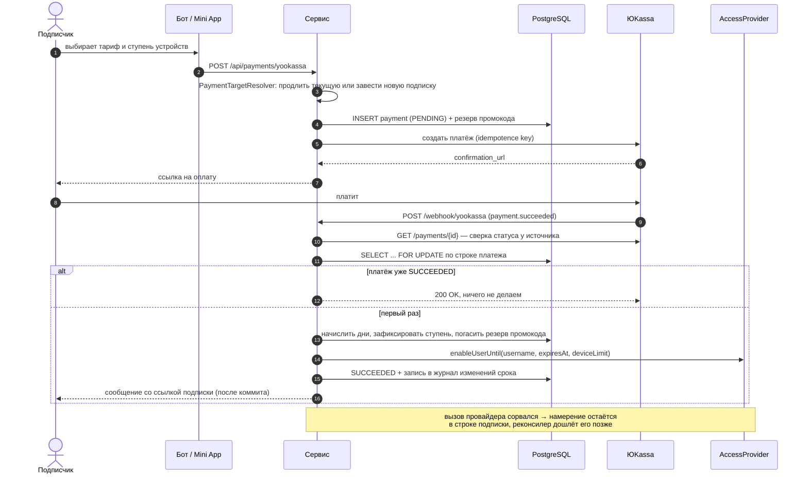

# Orchestra — сервис подписок с приёмом платежей

Backend сервиса, который продаёт подписки на цифровой продукт и сам выдаёт по ним доступ.
Витрина и личный кабинет живут внутри Telegram — как бот и как Mini App; оплата идёт через
ЮKassa (карты), Crypto Pay и Telegram Stars; после успешного платежа доступ выдаётся
автоматически, а по истечении срока так же автоматически отзывается.

Проект написан как разбор одной непростой задачи: **деньги и выдача доступа — это две разные
системы, и согласовывать их приходится без распределённых транзакций.** Платёж подтверждается
вебхуком, который может прийти дважды, не прийти вовсе или прийти после того, как пользователь
уже нажал «оплатить» второй раз. Доступ выдаёт внешний провайдер, который может не ответить.
Между ними — база, которая должна остаться консистентной в любом из этих случаев. Большая часть
кода здесь именно про это, а не про CRUD.

---

## Стек

| Слой | Технология | Версия |
|---|---|---|
| Язык | Java | 21 |
| Каркас | Spring Boot (Web, Data JPA, Actuator, Mail, WebFlux) | 3.5.16 |
| Telegram | telegrambots (long-polling starter + client) | 9.6.0 |
| База | PostgreSQL | 16 |
| Миграции | Liquibase (YAML changelog) | из BOM Spring Boot |
| Сборка | Maven + JaCoCo | 3.9 / 0.8.15 |
| Тесты | JUnit 5, Mockito, AssertJ, Testcontainers (Postgres) | из BOM Spring Boot |
| Контейнеризация | Docker (multi-stage), docker compose | — |
| CI/CD | GitHub Actions → GHCR → деплой по SSH | — |

Фронтенд Mini App и веб-кабинета — статика без сборочного шага: чистые HTML, CSS и JS,
которые Spring Boot отдаёт из `src/main/resources/static`.

---

## Поток платежа



Что здесь важно и почему сделано именно так:

- **Вебхуку не верят на слово.** Прежде чем что-то начислять, сервис сам спрашивает у ЮKassa
  статус платежа: тело вебхука приходит из сети и не является доказательством оплаты.
- **Идемпотентность на блокировке строки.** Повторная доставка вебхука (а ЮKassa доставляет
  с ретраями) встаёт в очередь за `SELECT … FOR UPDATE` и, увидев `SUCCEEDED`, ничего не
  делает. Без этого второй вебхук начислял бы дни второй раз.
- **Сеть — за пределами транзакции.** Отправка сообщений и писем вынесена в
  `afterCommit`: пока транзакция открыта, она держит блокировку строки платежа, и молчащий
  SMTP-узел превращается в очередь из повторных вебхуков.
- **Расхождение с провайдером не теряется.** Если начисление в базе прошло, а провайдер не
  ответил, в строке подписки остаётся намерение (`provider_intent`), которое подберёт
  реконсилер. Все вызовы провайдера задают абсолютное состояние, поэтому повтор безопасен.
- **Промокод резервируется, а не «проверяется».** Иначе последний слот `max_uses` успевали
  занять параллельные счета, а невыкупленные резервы освобождаются отдельной задачей.

Автопродление устроено так же: планировщик не имеет собственного пути начисления, а
списывает деньги и отдаёт результат в тот же обработчик, что и вебхук.

---

## Выдача доступа

Всё, что связано с конкретным способом раздачи доступа, спрятано за интерфейсом
[`AccessProvider`](src/main/java/com/orchestra/subscriptions/access/AccessProvider.java) —
семь методов: завести аккаунт, прочитать, включить до даты, выключить, перевыпустить токен,
список узлов. Подписки, платежи, промокоды и жизненный цикл от него не зависят.

В этом репозитории есть одна реализация —
[`LocalAccessProvider`](src/main/java/com/orchestra/subscriptions/access/LocalAccessProvider.java):
она выдаёт аккаунту случайный непрозрачный токен, собирает из него ссылку и держит состояние
в памяти процесса. Наружу не ходит, ключей не требует. В продуктовой системе на этом месте
стоит HTTP-клиент управляющей панели с теми же семью методами — замена реализации не трогает
ни одного другого класса.

Клиент подписчика ходит за параметрами доступа на наш собственный эндпоинт
`GET /sub/{token}` ([`AccessDeliveryController`](src/main/java/com/orchestra/subscriptions/web/AccessDeliveryController.java)),
а не к провайдеру напрямую. Разница не косметическая: через этот запрос проходят учёт
устройств, проверка срока и заморозка — и вместо голого 404 у истёкшей подписки человек
получает строку-уведомление, которую видит прямо в списке серверов.

---

## Что внутри

```
src/main/java/com/orchestra/subscriptions/
├── access/        AccessProvider (интерфейс) + локальная реализация + владение аккаунтом
├── bot/           экраны и команды Telegram-бота, роутер колбэков, гейт подписки на канал
├── client/        HTTP-клиенты: ЮKassa, Crypto Pay, Uptime Kuma
├── config/        @ConfigurationProperties, таймауты WebClient, меню бота
├── model/         JPA-сущности: Customer, Subscription, Payment, PromoCode, UserDevice, …
├── repository/    Spring Data репозитории
├── service/       бизнес-логика: платежи, подписки, устройства, промокоды, рефералы, рассылки
│   └── payment/   выбор цели платежа: продлить текущую подписку или завести новую
├── util/          формат денег и дат, клавиатуры, маскирование токенов и email
└── web/           вебхуки, выдача доступа, авторизация узлов
    └── api/       REST для Mini App, веб-кабинета и админ-панели

src/main/resources/
├── db/changelog/  миграции Liquibase, по одному файлу на изменение
└── static/        Mini App (/app), кабинет подписчика (/account), админ-панель
```

Ключевые сервисы:

| Класс | За что отвечает |
|---|---|
| `PaymentProcessingService` | обработка вебхуков, начисление, возвраты, докупка устройств |
| `PaymentTargetResolver` | куда зачислить деньги: в текущую подписку или в новую |
| `AccessService` | жизненный цикл доступа: пробный период, активация, отзыв |
| `AccessSyncService` | досылка состояния провайдеру, закрытие незавершённых намерений |
| `SubscriptionLedgerService` | журнал изменений срока — по нему разбирают спорные случаи |
| `DeviceTrackingService` | учёт устройств по идентификатору, лимиты и ступени тарифа |
| `PromoCodeService` | резерв, погашение и освобождение промокодов |
| `AutoRenewService` | периодическое списание через общий путь обработки платежа |
| `DynamicConfigService` | горячая перезагрузка списка узлов без пересборки образа |

---

## Запуск локально

Нужны Docker и Docker Compose. JDK и Maven — только если хочется запускать без контейнера.

```bash
git clone <repo> && cd orchestra-subscriptions
cp .env.example .env
```

В `.env` достаточно заполнить три поля, чтобы приложение поднялось:

- `BOT_TOKEN` — токен тестового бота от [@BotFather](https://t.me/BotFather);
- `BOT_USERNAME` — его username без «@»;
- `DB_PASS` — любой пароль для локальной базы.

`YOOKASSA_SHOP_ID`, `YOOKASSA_SECRET_KEY` и `YOOKASSA_RETURN_URL` обязательны для старта
(у них нет значений по умолчанию), но для локального запуска подойдут любые непустые строки:
без реальных ключей просто не создастся платёж.

```bash
docker compose up --build
```

Поднимутся два контейнера — PostgreSQL и приложение. Проверка:

```bash
curl http://localhost:8080/actuator/health
```

Mini App открывается в обычном браузере на <http://localhost:8080/app/>: вне Telegram
`window.Telegram.WebApp` не существует, и фронт подставляет демо-данные, так что витрину и
экраны видно без бота и без оплаты.

Только база, а приложение из IDE:

```bash
docker compose up postgres
mvn spring-boot:run
```

Совсем без Docker — профиль `dev` с H2 в памяти и выключенным Liquibase:

```bash
mvn spring-boot:run -Dspring-boot.run.profiles=dev
```

### Тесты

```bash
./mvnw test
```

813 тестов. Интеграционные поднимают настоящий PostgreSQL через Testcontainers, поэтому
для них нужен работающий Docker. Отчёт о покрытии — `target/site/jacoco/index.html`.

---

## Конфигурация

Все настройки живут в `application.yml` под префиксом `app.*` и биндятся в
[`AppConfig`](src/main/java/com/orchestra/subscriptions/config/AppConfig.java). Секретов в
репозитории нет: каждое чувствительное значение подставляется из переменной окружения, полный
список с комментариями — в [`.env.example`](.env.example).

Тарифы (`app.plans`), ступени устройств (`app.device-tiers`) и правила выдачи второй подписки
(`app.multi-subscription`) — тоже конфигурация, а не код: цену и число устройств меняют правкой
YAML. Список узлов вдобавок перечитывается на живом приложении командой `/reloadconfig`
без пересборки образа.

---

## Развёртывание

`.github/workflows/ci-cd.yml` на каждый push и pull request прогоняет тесты и публикует отчёт
о покрытии. На `main` дополнительно собирается Docker-образ, пушится в GHCR с двумя тегами
(`latest` и SHA коммита) и разворачивается на сервере по SSH.

Шаг деплоя намеренно недоверчив: он проверяет, что запущенный контейнер поднялся именно на
образе `:latest` (а не остался на старом после сбоя `pull`), и дожидается `healthy` от
`HEALTHCHECK`. Битая миграция или пропавшая переменная окружения дают crash-loop при
формально зелёном деплое — без этой проверки о них узнают от пользователей.

Адреса и ключи в workflow не зашиты: `DEPLOY_HOST`, `DEPLOY_USER` и `DEPLOY_SSH_KEY` берутся
из секретов репозитория. Все сторонние экшены закреплены по коммит-SHA, а не по тегу: тег
владелец экшена может передвинуть на любой коммит, а шаг деплоя отдаёт экшену ключ от сервера.
